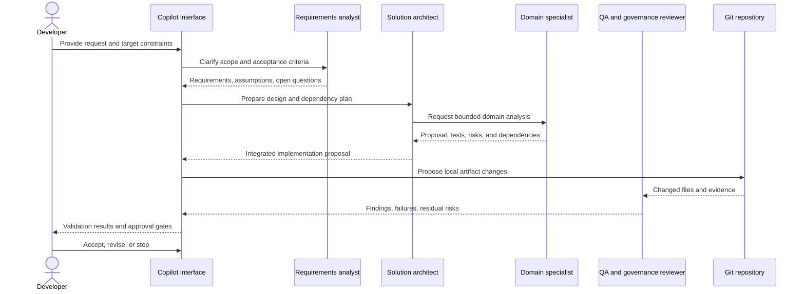

# Agent Orchestration

Status: proposed workflow; installed agent schema and delegation support remain unverified.

## Flow

## Rules

- Requirements and target environment are clarified before authoring.
- Specialist work is bounded to a domain and cannot widen permissions or target environments.
- The authoring agent and independent QA reviewer are separate roles; generated work is never self-approved.
- Validation is performed locally with synthetic or mocked data when possible.
- Any live service access requires a previously approved tool and target. Any external write pauses for operation-specific human approval.
- The deployment reviewer may prepare a runbook but must not execute it.

## Failure Handling

Missing requirements, an unavailable tool, ambiguous identity, or an unknown target results in a stop-and-clarify outcome, not a guessed value or fallback to production.
