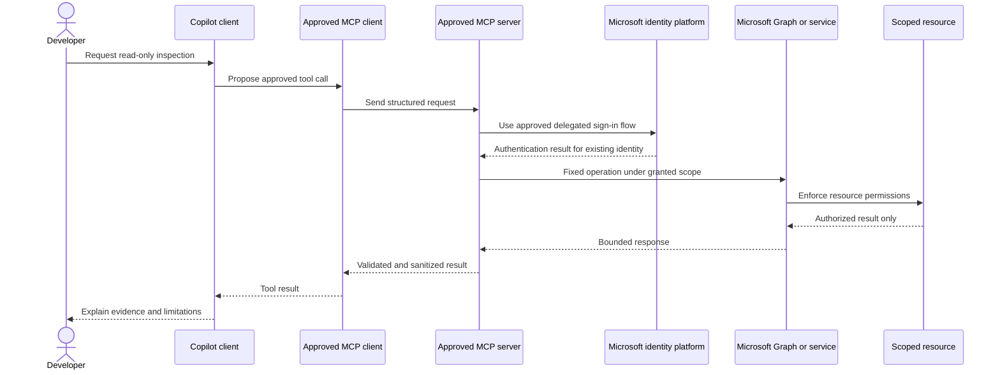

# Authentication and Authorization

Status: proposed; no Microsoft service authentication was attempted.

## Trust and Identity Flow

## Authorization Principles

- Prefer a developer's existing delegated identity for an approved local read-only integration.
- Never assume tenant, Fabric, Power Platform, SharePoint, Azure, or Entra administrator privileges.
- Do not create an app registration, service principal, credential, or permission grant in this phase.
- Do not store tokens, refresh tokens, secrets, or certificates in Git, prompts, logs, screenshots, test fixtures, or generated documentation.
- A repository allowlist can restrict a client but cannot grant a permission. Microsoft service-side authorization and the signed-in user's access remain authoritative.
- Prompt content, agent role, and site/list identifiers supplied by a model are never authorization.
- For a missing permission, stop and request the minimum documented scope through the organization's approval path; do not broaden permissions as a workaround.
