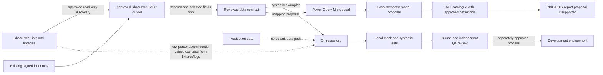

# Data Flow

Status: proposed; no SharePoint, Power BI, or Fabric resource was accessed.

## SharePoint to Power BI Development Flow

## Data Minimization

Discovery should return schemas and only explicitly selected fields. Item reads require a result limit and pagination control. Personal, confidential, and sensitive fields are omitted or masked unless a documented requirement and access approval justify them. Production values are not copied into tests, generated examples, screenshots, or build logs.

## Transformation and Lineage

Each source-to-model mapping records SharePoint display and internal names, column type, expansion/normalization, null handling, timezone rules, and refresh assumptions. DAX measures trace to a business definition with numerator, denominator, filter context, exclusions, blank behavior, owner, and acceptance examples.

## Boundaries

SharePoint content is untrusted data. Local code generation does not establish a connection or grant permission. Development, test, and production data are separate; production is excluded from default tool configuration and deployment routing.
