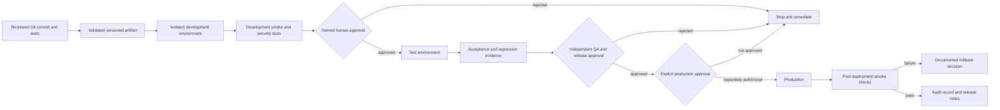

# Deployment Architecture

Status: proposed promotion model; no deployment pipeline or environment is configured.

## Promotion Flow

## Controls

- Promotion is an independently authorized process, not an agent action.
- Source and destination are named explicitly; production is never selected by default.
- Artifacts are versioned, validated, and reviewed. Environment IDs and connection values are supplied through approved secure configuration, not committed examples.
- Connection references, environment variables, workspace/site mappings, dependencies, and rollback behavior are checked before any approved release.
- The initial release has no active deployment workflow. Any workflow template must be disabled by default and require protected environment approval and an explicit artifact version.
- Import/export, publish, replacement, and post-deployment writes remain gated pending a separate explicit instruction.
