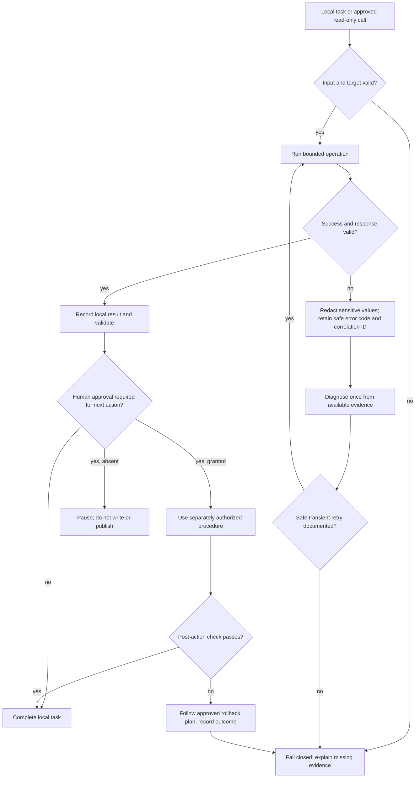

# Architecture Limitations

Status: known constraints at initial setup.

- Phase 0 did not detect a GitHub Copilot VS Code extension, an operational Copilot CLI, Power BI Desktop, Power Platform CLI, Azure CLI, or .NET SDK. Availability and compatibility must be rechecked before choosing an implementation path.
- The local environment check cannot determine organization approval, tenant settings, server-side plugin availability, Graph consent, Fabric capacity, or user permissions.
- Local absence of MCP configuration does not prove that no organization-approved SharePoint MCP server exists.
- PBIP/PBIR support and command/package formats are unverified. No format compatibility is claimed.
- No live resource was accessed. All architecture diagrams are target-state proposals, not evidence that an integration works.
- Local tests cannot prove a production deployment is safe. Service-specific validation and human approvals remain necessary.
- No automatic deployment, permission change, sharing, production write, deletion, or tenant configuration is supported by this initial scaffold.

## Error Handling and Rollback

Rollback is a plan, not an autonomous permission to make another write. A failed operation pauses for human direction unless a pre-approved, safe recovery procedure explicitly covers it.
