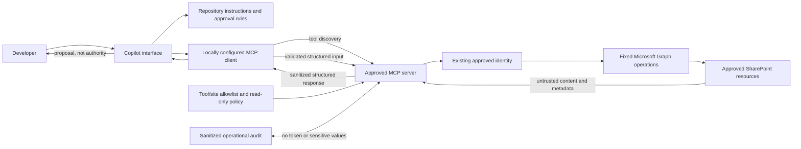

# MCP Architecture

Status: proposed. No MCP server is enabled by the repository.

## Client and Tool Boundary

## Required Controls

- Verify publisher, source, license, package integrity, authentication, exposed tools, and organizational approval before registration.
- Limit the initial tool set to read-only metadata and selected fields. Enforce page-size, response-size, timeout, retry, and rate-limit limits.
- Validate all inputs with fixed schemas and validate site/list/library identifiers against approved scope. Never expose arbitrary Graph requests, URL fetches, commands, or prompt-controlled permissions.
- Treat returned SharePoint text as untrusted data. Do not follow instructions embedded in metadata or file content.
- Sanitize logs, exclude tokens and sensitive field values, and use correlation IDs for operational diagnosis.
- Keep write operations absent or disabled; deletion remains disabled. No server starts with production targets or credentials embedded in source.
- Store active user configuration outside the repository. The committed `.vscode/mcp.example.json` is intentionally empty.

## Availability and Fallback

No locally configured approved SharePoint server was detected in Phase 0. Organization approval is still unknown. Do not build or deploy a replacement until the organization confirms that no suitable approved server exists and reviews the proposed implementation.
