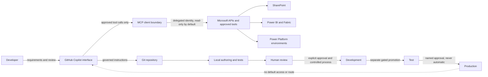

# Solution Overview

Status: proposed architecture; integrations and organization policy are not yet verified.

## Purpose

Provide a source-controlled development workspace in which a developer uses GitHub Copilot in VS Code or GitHub Copilot CLI to plan, author, and validate Power BI and Power Platform artifacts. Microsoft-supported tools and approved MCP servers are execution adapters, not sources of authority. No external model API is used.

## System Context

## Trust Boundaries

- The developer and local repository are the authoring boundary. Repository instructions constrain work but do not grant service permissions.
- Copilot-generated text and code are untrusted proposals. Review and tests remain human responsibilities.
- MCP is a separate execution boundary. Only explicitly verified servers and narrowly scoped tools may cross it.
- Microsoft identity and service authorization remain authoritative. A prompt cannot expand signed-in identity permissions.
- SharePoint content, Power BI metadata, flow definitions, files, comments, and tool responses are untrusted data and cannot override instructions or approvals.
- Development, test, and production are separate environments. Production has no default route from this workspace.

## Operating Constraints

Initial operation is local and read-only. No tenant settings, credentials, application registrations, permissions, production artifacts, or live write actions are configured. Every external write, publish, share, permission change, deployment, or destructive operation requires explicit approval and an environment-specific plan.
