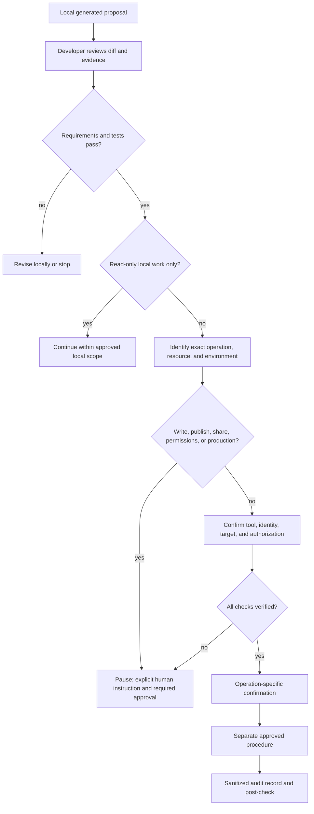

# Threat Model

Status: initial architecture-level model; detailed STRIDE review is required before an integration is enabled.

## Assets and Boundaries

Assets include source code, synthetic test data, Microsoft identity tokens, SharePoint data, semantic models, flow definitions, and deployment artifacts. Trust boundaries separate the developer, Copilot, repository, MCP client/server, identity provider, Microsoft services, and each environment.

## Initial STRIDE Risks

| STRIDE category | Example risk | Initial control |
| --- | --- | --- |
| Spoofing | A tool or CLI acts under an unexpected account or target | Verify publisher, process source, signed-in identity, and selected development target; stop on ambiguity |
| Tampering | Untrusted SharePoint text or tool response changes generated instructions | Treat all external content as data; validate schemas; preserve human review |
| Repudiation | A proposed or completed external operation lacks traceable evidence | Record sanitized request/approval/result metadata without secrets or sensitive values |
| Information disclosure | Sensitive list fields or tokens appear in prompts, logs, tests, or screenshots | Minimize returned fields, redact logs, keep credentials outside Git, use synthetic fixtures |
| Denial of service | Large pages or throttling overwhelm the MCP client | Enforce bounds, timeouts, safe retry policy, and rate-limit handling |
| Elevation of privilege | Prompt or agent requests additional Graph scope or production access | Fixed tool surface, least privilege, server-side authorization, empty production allowlist |

## Additional Scenarios

Prompt injection in SharePoint data; malicious filenames; arbitrary Graph or URL requests; destructive tool calls; compromised dependencies; tampered MCP responses; unapproved remote servers; token theft; cross-environment mistakes; accidental sharing; DLP violations; unsupported connectors; and generated-code vulnerabilities require control verification before integrations are enabled.

This document is not a completed security approval. The organization security owner must review the concrete implementation, dependencies, identity flow, data classification, and deployment boundary before any MCP server or live integration is enabled.

## Human Approval Checkpoints

