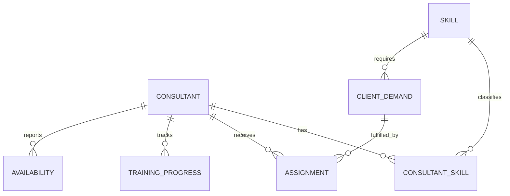

# Entity Relationships

Status: conceptual relationship proposal; key/cardinality behavior requires source-owner confirmation.

## Relationship Rules

- `Consultants.ConsultantKey` is the proposed stable dimension key; `Skills.SkillKey` is the proposed skill key.
- ConsultantSkills is a bridge for a many-to-many Consultant/Skill business relationship; preserve a unique bridge key and validate duplicate pairs.
- Assignments may link to ClientDemand only if the business process defines a reliable demand key. Do not infer demand fulfillment from similar text.
- Availability is time-bounded and may have overlapping intervals; define grain and overlap resolution before aggregating.
- TrainingProgress is event/record-grain; define whether multiple attempts produce one latest status or multiple facts.
- Orphaned lookups, duplicate keys, invalid date ranges, and overlapping allocation totals become synthetic data-quality cases.
